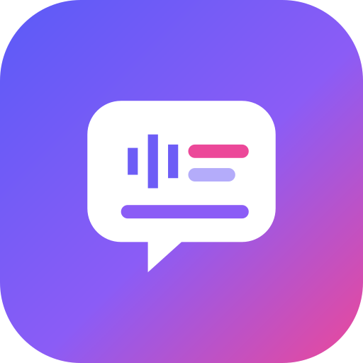
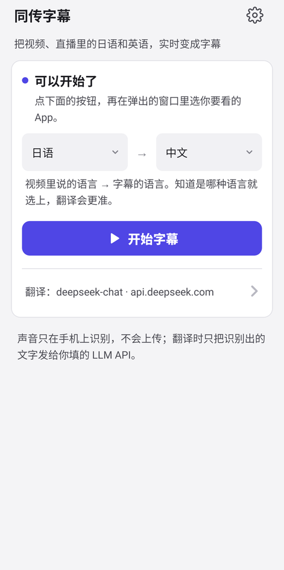
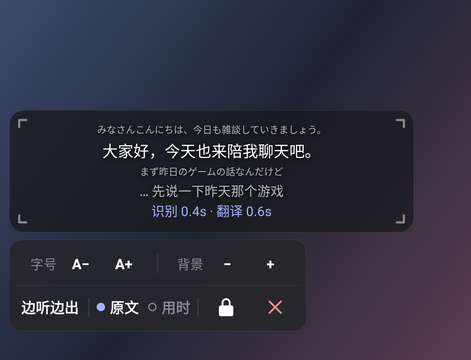
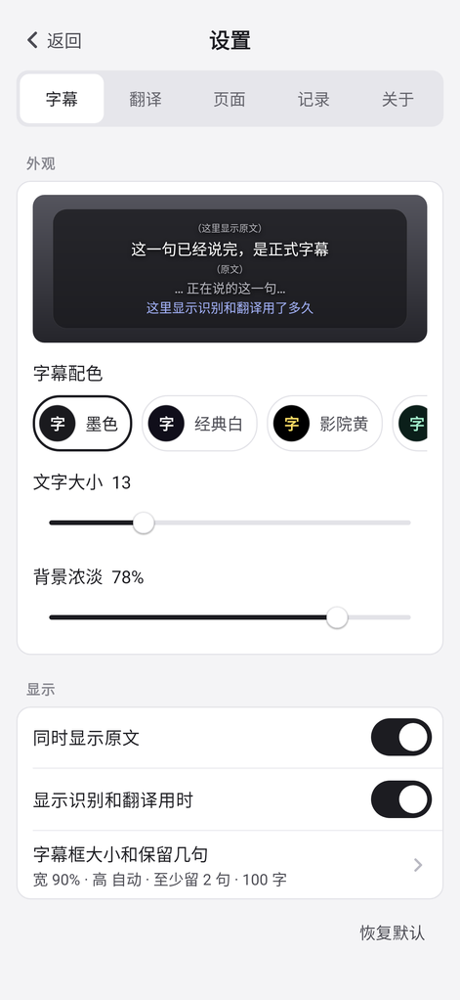
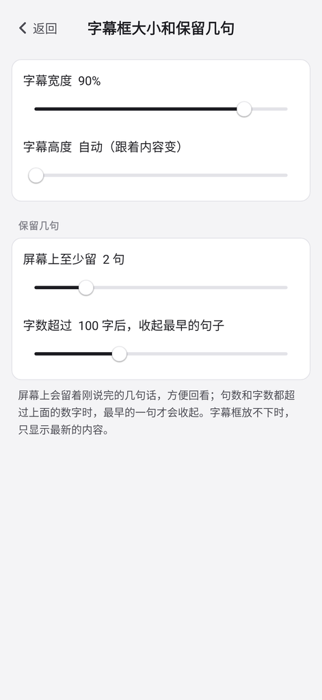
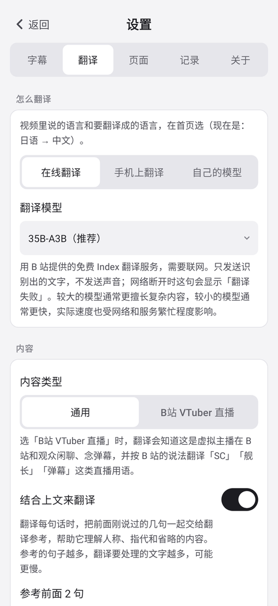
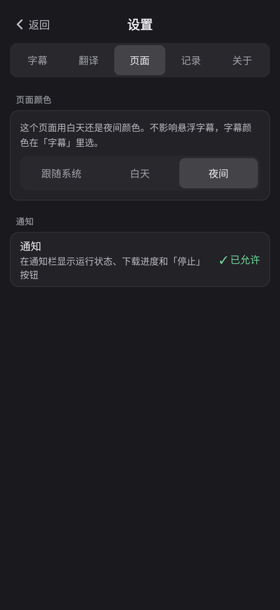
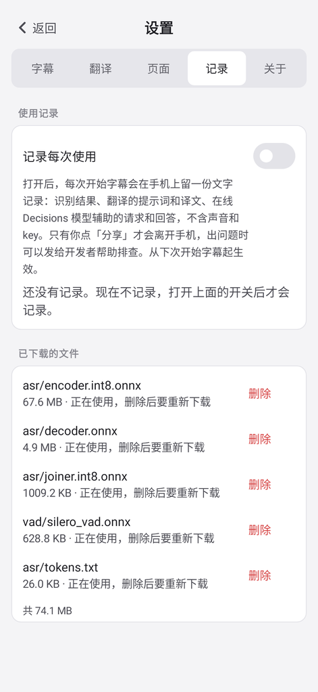
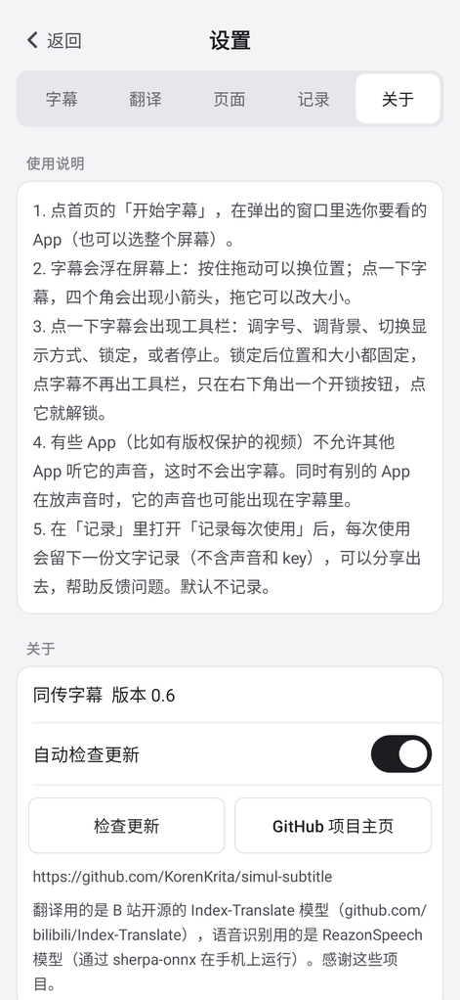
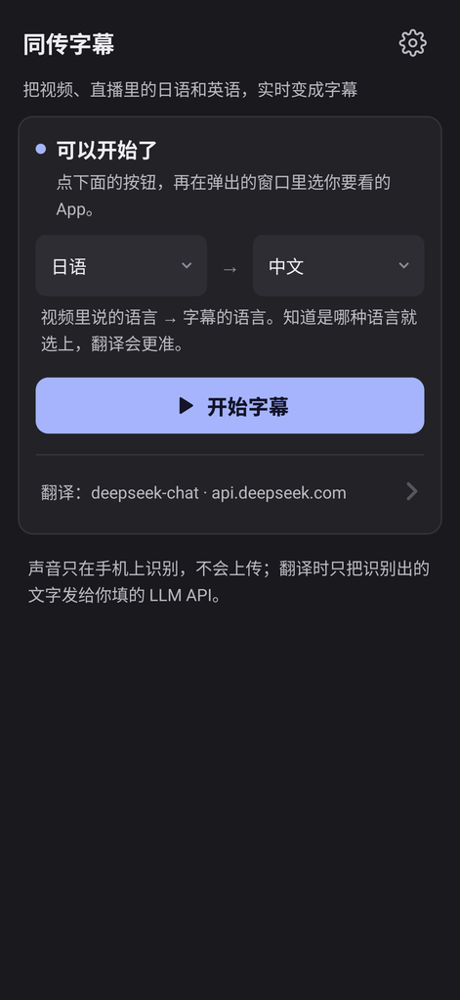

  

<h1 align="center">Simul Subtitle（同传字幕）</h1>

  Live subtitles for Japanese and English videos and streams, on your Android phone or your computer (Mac, Windows), 
  translated into Chinese or any language you name, on top of any app.

  <a href="README.md">中文</a> ·
  <a href="docs/README.md">Technical docs (Chinese)</a>

---

## Screenshots

<table>
  <tr>
    <td></td>
    <td></td>
    <td></td>
    <td></td>
    <td></td>
    <td></td>
    <td></td>
    <td></td>
    <td></td>
  </tr>
  <tr>
    <td align="center">Home</td>
    <td align="center">Floating subtitles (tap for the toolbar)</td>
    <td align="center">Settings · Subtitles</td>
    <td align="center">Subtitle box size and kept sentences</td>
    <td align="center">Settings · Translation</td>
    <td align="center">Settings · Page (dark)</td>
    <td align="center">Settings · Records</td>
    <td align="center">Settings · About</td>
    <td align="center">Home (dark)</td>
  </tr>
</table>

## What it does

- **Works with most apps**: Bilibili, YouTube, streaming apps, the browser… any app that allows its playback to be captured; a few apps and DRM-protected video do not.
- **Floating subtitles**: shown over the video like movie subtitles; move them anywhere, change size, colour and background.
- **As people speak**: text appears while someone is talking and becomes a final subtitle when the sentence ends.
- **Speech stays on the phone**: audio is recognised on the device and **never uploaded**.
- **Any caption language**: Chinese, English, Japanese and Korean in the list; for any other (e.g. French, Traditional Chinese, Cantonese) pick 自己填… and type it.
- **Tell the translator what you watch**: a built-in Bilibili VTuber scene, or your own: a short background and a term list (source word, translation), which your LLM can also draft from the background.
- **Bring your own translation model**: enter the address, model ID and key of any OpenAI-compatible service (e.g. DeepSeek, Qwen); you pay your provider for your own usage.

## Get started in three steps

1. **Set up the LLM API**: on first launch the home screen asks for it; tap 去填写 (or go to Settings → 翻译), fill in the service address, model ID and API key, then tap 测试连接 (test). The model must be able to turn thinking off and should answer fast (see the FAQ).
2. **Allow**: let the app hear other apps' sound and draw over other apps.
3. **Start**: tap 开始字幕, pick the app you want to watch, and go back to your video.

The speech recognition models ship inside the app; nothing else to download.

Subtitle size, colours and translation options are in Settings.

On the subtitle: **drag** to move · **tap** for the toolbar (text size, background, display mode, original text and timings on/off, lock, stop); while it is shown, **drag a corner mark** to resize · **locked**: position and size are fixed, a tap only shows an unlock button.

The app's interface is in Chinese.

## Install

- Android 10 or newer, arm64.
- Download the APK from the [Releases](../../releases) page and open it on the phone (allow "install unknown apps").
- From 0.4, the app checks for updates when opened. Read what's new and install, skip a version, or turn checks off; manual checking is always available under Settings → About.
- To build it yourself, see [docs/build.md](docs/build.md).

### Mac

- Apple silicon (M1 or later), macOS 14.2 or newer.
- Download `SimulSub-<version>-mac-arm64.dmg` from [Releases](../../releases), open it and drag 同传字幕 into Applications.
- The dmg is not notarized. The first time, macOS says it cannot verify the developer: right-click the app in Applications and choose Open, or click "Open Anyway" in System Settings → Privacy & Security.
- On the first start of captions, allow system audio recording (System Settings → Privacy & Security → Screen & System Audio Recording).
- The captions follow everything the Mac plays, no microphone needed; they float above all windows and can sit on an external display.
- Closing the main window keeps the captions on; the menu bar icon starts and stops them and reopens the window.
- Home and Settings are the same as on the phone. Update checks only open the download page; replace the app with the new dmg yourself.
- Settings and usage logs live in `~/Library/Application Support/SimulSub/`, keys in the keychain; deleting the app leaves them.

### Windows

- Windows 10 / 11, 64-bit (x64).
- Download `SimulSub-<version>-windows-x64.zip` from [Releases](../../releases), unzip it anywhere and run `SimulSub.exe`. Nothing to install.
- The program is not signed. The first time, Windows may say it protected your PC: click "More info" → "Run anyway".
- The captions follow everything the default output device plays, no microphone needed; a new default device (headphones in or out) is followed.
- Closing the main window keeps the captions on; the icon in the notification area starts and stops them and reopens the window. To quit, right-click it and choose 退出.
- Requests go through the system proxy, and straight to a service the proxy cannot reach.
- Update checks only open the download page: quit the app, then replace its folder with the new zip's.
- Settings and usage logs live in `%APPDATA%\SimulSub\`; keys are in `keys.json` there, encrypted with Windows' DPAPI so only your Windows account can read them. Deleting the folder leaves them.

## FAQ

**Why are there no subtitles for some apps?**
Some apps (for example DRM-protected video) do not allow other apps to capture their audio. This is an Android restriction.

**Which spoken languages?**
Japanese and English. Choosing the right one on the home screen makes the translation more accurate.

**Is my audio uploaded?**
No. Audio is turned into text on the phone; for translation only the recognised text is sent to the service you entered. See [docs/privacy.md](docs/privacy.md).

**Which translation model should I use?**
One that can turn thinking (reasoning) off, otherwise every sentence takes a long wait; and preferably one that answers fast, so the subtitles keep up. The first time a model is used, the app finds out by itself how to turn its thinking off and remembers it.

## Acknowledgements

Built on these open-source projects:

- **[ReazonSpeech](https://github.com/reazon-research/ReazonSpeech)**: Japanese / English speech recognition (the app uses the sherpa-onnx export [reazonspeech-k2-v2-ja-en](https://huggingface.co/csukuangfj/reazonspeech-k2-v2-ja-en)).
- **[sherpa-onnx](https://github.com/k2-fsa/sherpa-onnx)**: speech recognition and voice activity detection ([Silero VAD](https://github.com/snakers4/silero-vad)) on the phone and the computer.

The optional online Decisions model assistance (sentence ends, translation checks) uses **[TypeSafe Jev](https://typesafe.ai)**, a closed-source commercial cloud service (not open source), off by default. With a paid endpoint it is billed by usage: about US$0.04 per hour of speech (see [docs/jev.md](docs/jev.md)).

---

License: [MIT](LICENSE). The models and third-party libraries keep their own licenses.
